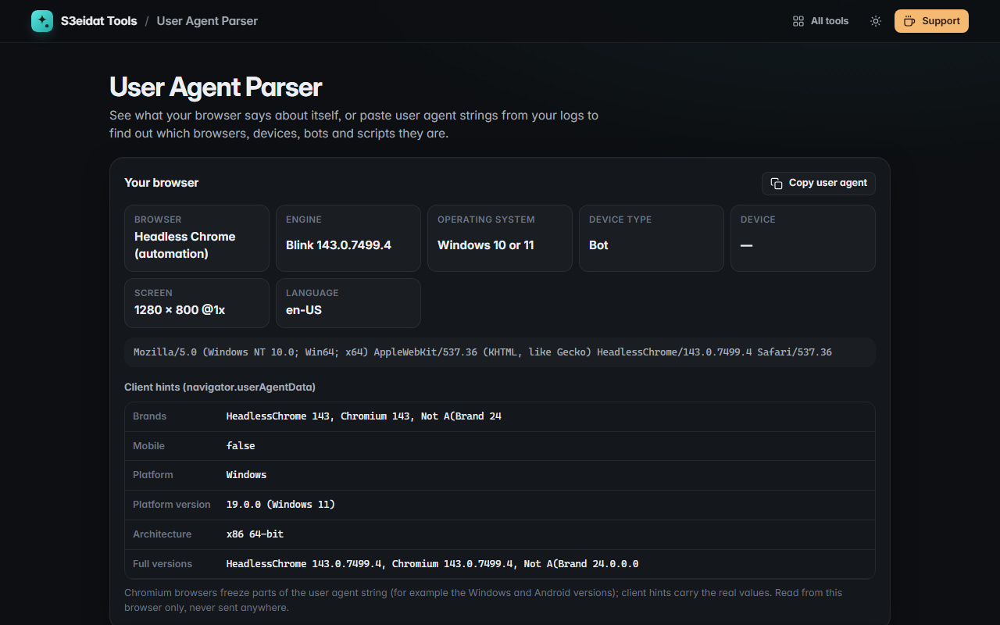

# User Agent Parser

> Decode any browser user agent: browser, engine, OS, device type, bots and HTTP clients. Free, private, and it runs entirely in your browser.

### ▶ [Open User Agent Parser](https://s3eidat.github.io/ua-parser/)



## Features

- **Your browser**: your own user agent, parsed, plus **User-Agent Client Hints** (`navigator.userAgentData`: brands, platform, platform version, architecture, model) where the browser offers them
- **Bulk parsing**: paste user agents one per line, or open an access log (the last quoted field of each line is used)
- Browser and version (Chrome, Safari, Firefox, Edge, Opera, Samsung Internet, Yandex, Vivaldi, UC, DuckDuckGo, in-app browsers, WebViews, IE…)
- Rendering engine (Blink, WebKit, Gecko, Trident, EdgeHTML, Presto)
- OS and version (Windows, macOS, iOS, iPadOS, Android, ChromeOS, Linux distributions, HarmonyOS, KaiOS, Tizen, webOS…)
- **Device type**: desktop, mobile, tablet, TV, console, bot or HTTP client; vendor and model for Android phones (Samsung, Pixel, Xiaomi, OPPO…)
- **Bots**: search engines, social previews, SEO crawlers, AI crawlers (GPTBot, ClaudeBot, PerplexityBot, CCBot…), monitors and headless browsers
- **HTTP clients**: curl, Wget, Python requests / httpx / aiohttp, Go, OkHttp, axios, Node, Postman, Java, PowerShell and more
- **Table** or **JSON** output; copy, or download CSV / JSON (CSV cells are guarded against spreadsheet formulas)

User agents can be faked, and modern Chromium browsers freeze parts of the string (Windows 10 and 11 look the same; Android models
show as `K`). Results are a best reading of the string, not proof of the real device.

## Privacy

Everything happens on your device. There is no server, no account, no analytics.
The page ships with a strict Content-Security-Policy (`connect-src 'self'`), so the browser
itself blocks any attempt to send data anywhere.

## Run it yourself

It's plain HTML, CSS and JavaScript with no build step:

```bash
git clone https://github.com/s3eidat/ua-parser
cd ua-parser
python -m http.server 8000
```

Then open http://localhost:8000.

## Support

If this saved you time, **[buy me a coffee ☕](https://s3eidat.github.io/coffee/)**. It keeps every tool free.

---

Part of **[S3eidat Tools](https://s3eidat.github.io/)**: 100+ free, private tools that run in your browser. MIT licensed.
